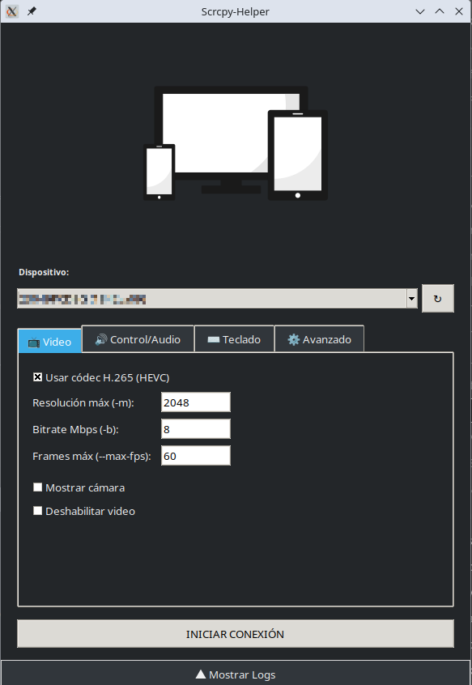

# 📱 Scrcpy-Helper (v1.4.1)

Una interfaz gráfica sencilla y ligera construida en Python con Tkinter para gestionar conexiones de [scrcpy](https://github.com/Genymobile/scrcpy?tab=readme-ov-file) con detección dinámica de dispositivos.

(Compatible con scrcpy(v3))

## 🚀 Características

- Detección Automática: Detecta tus móviles vía ADB al instante.
- Sin Dependencias de Entorno: Funciona en KDE, GNOME, XFCE o cualquier gestor de ventanas sin instalar librerías extra de GTK/Qt.
- Portable: Disponible como binario único gracias a Nuitka.
- Privacidad: Ejecución 100% local y transparente.
- Se guardan las opciones elegidas previamente en `~/.config/scrcpy-helper`.
- Botón de recarga para ver nuevos dispositivos conectados.
- Conexión rápida con tecla "Barra espaciadora"
- Alias de dispositivos: el botón ✎ asigna un nombre (máx. 30 caracteres) al dispositivo seleccionado; se muestra como «Alias (Modelo)». Dejarlo vacío quita el alias.
- Errores en cuadro de diálogo con su tipo (adb, dispositivo, argumentos extra, scrcpy) y una sugerencia; los detalles quedan en la consola de logs.
- Aviso de conexión finalizada en la consola de logs, con el código de salida de scrcpy.
- Selección estable: al iniciar la conexión, la lista no se recarga y se conserva el dispositivo elegido con sus opciones.
- Pestaña «Acerca de» con la versión del programa (también visible en el título de la ventana), el enlace al repositorio, la licencia y la ruta del archivo de configuración.

## 🛠 Requisitos Previos

**En Arch Linux**

    sudo pacman -S android-tools scrcpy

**En Ubuntu/Debian**

    sudo apt install adb scrcpy

**Nota**: Recuerda tener activada la Depuración USB en las opciones de desarrollador de tu dispositivo Android.

**Nota sobre el PATH**: `adb` y `scrcpy` deben estar en el PATH de la sesión gráfica. Los lanzadores del menú de aplicaciones no leen `~/.zshrc`, así que un `adb`/`scrcpy` añadido al PATH solo ahí no se encontrará al abrir el programa desde el menú. Solución: instálalos con el gestor de paquetes del sistema (comandos de arriba) o enlázalos en `/usr/local/bin`, por ejemplo:

    sudo ln -s "$(command -v adb)" /usr/local/bin/adb
    sudo ln -s "$(command -v scrcpy)" /usr/local/bin/scrcpy

## 📥 Instalación y Uso

- Ve a la sección de Releases y descarga el archivo `scrcpy-helper-linux` (en Windows, `scrcpy-helper-windows.exe`).
- Dale permisos de ejecución al archivo:
  
**Bash**

    chmod +x scrcpy-helper-linux

    ./scrcpy-helper-linux

**Interfaz Gráfico**
- Click derecho, propiedades, marcar "es ejecutable"
- Doble click a `scrcpy-helper-linux`

## 🛡 Verificación de Integridad

Para garantizar que el archivo no ha sido alterado, puedes verificar su hash SHA-256:

- Descarga el binario y su archivo de suma (`checksum-linux.txt` o `checksum-windows.txt`) en la misma carpeta.
- Ejecuta:
    - sha256sum -c checksum-linux.txt
    - Si todo es correcto, verás: `scrcpy-helper-linux: La correspondencia es exacta`.

## Compilación manual

Son los mismos pasos que usa `.github/workflows/build.yml` (Python 3.10).

**Linux**

Requisitos:

    sudo apt install python3-tk patchelf
    pip install nuitka zstandard

(`build.yml` solo instala `zstandard` en el job de Windows.)

Descarga los archivos fuente y ejecuta:

    python3 -m nuitka \
    --standalone \
    --onefile \
    --enable-plugin=tk-inter \
    --include-data-files=ico.png=ico.png \
    --include-data-dir=locales=locales \
    --linux-icon=ico.png \
    --remove-output \
    -o scrcpy-helper-linux \
    scrcpy_helper.py

**Windows** (PowerShell)

Requisitos:

    pip install zstandard nuitka

Ejecuta:

    python -m nuitka `
    --standalone `
    --onefile `
    --enable-plugin=tk-inter `
    --include-data-files=ico.png=ico.png `
    --include-data-dir=locales=locales `
    --windows-icon-from-ico=ico.ico `
    --windows-console-mode=disable `
    --assume-yes-for-downloads `
    --remove-output `
    -o scrcpy-helper-windows.exe `
    scrcpy_helper.py

## Desinstalación completa
Adjunto hay un script `uninstall.sh` el cual se encargará de borrar todo rastro de este programa. 

## Tabs con opciones

**Video**

- `--video-codec=h265` "Usar códec h265"
- `-m {max-res}` "limitar la resolución a max-res (por ejemplo 1024)"
- `-b {Mbps}` "limitar el bit rate a Mbps (default 8M)"
- `--max-fps={fps}` "limitar los frames a fps"
- `--video-source=camera` "Mostrar la cámara"
- `--no-video` "Deshabilitar el video"

**Control / Audio**

- `-S` "Apagar pantalla del dispositivo"
- `-w` "Mantener encendido"
- `-power-off-on-close` "Apagar al cerrar la aplicación"
- `-t` "Mostrar toques"
- `-n` "Deshabilitar el control"
- `--no-audio` "Deshabilitar el audio"
- `--audio-source=mic` "Capturar el micrófono"

**Teclado**

- `--prefer-text` "Preferir eventos de texto"
- `--raw-key-events` "Forzar raw key events"
- `--no-key-repeat` "Evitar repetición de teclas"

**Avanzado**

Cuadro de texto para comandos personalizados. Para más información, vea la [documentación](https://github.com/Genymobile/scrcpy/tree/master/doc).

## Referencias

Icono tomado de [madartzgraphics](https://pixabay.com/es/illustrations/artilugio-dispositivos-tecnolog%c3%ada-1917227/)

